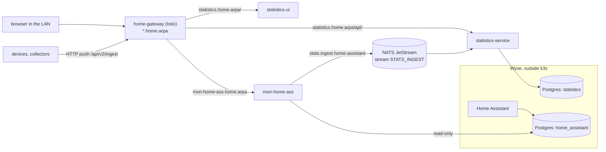
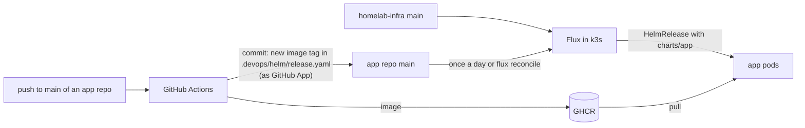
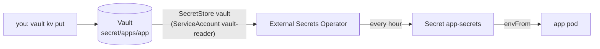

# Architecture

How the parts fit together. Setup steps: [setup.md](setup.md).

## Machines

| Machine | Role | Runs |
| --- | --- | --- |
| Raspberry Pi 5 (arm64, `homelab/node=rpi`) | k3s server | Istio control plane, Vault, NATS, app pods |
| Dell Wyse 5070 (amd64, `homelab/node=wyse`) | k3s agent | app pods; outside k3s: Postgres and Home Assistant |

Postgres is not in the cluster. Service `postgres.apps` points at the Wyse IP ([postgres.md](postgres.md)).

## Requests and data

- The browser loads statistics-ui and calls statistics-service on the same host under `/api/`, so no CORS is needed.
- Data gets into statistics-service in two ways: HTTP push from devices, or messages from NATS. mon-home-ass reads Home Assistant's 5-minute statistics and publishes them every 60 s. Details: [statistics-service README, "How data gets in"](https://github.com/jagieloadrian/statistics-service#how-data-gets-in).
- Inside the cluster Istio ambient encrypts pod-to-pod traffic. AuthorizationPolicies decide which ServiceAccount may call what: the gateway → apps, statistics-service and mon-home-ass → NATS.

## Delivery

- homelab-infra holds the platform and the shared chart `charts/app`. Each app repo holds only its HelmRelease and values in `.devops/helm/` ([apps.md](apps.md)).
- Flux reads homelab-infra every minute and app repos once a day. To deploy right away: `flux reconcile kustomization <app> -n flux-system --with-source`.

## Secrets

Git holds only which Vault path to read, never values. After a restart Vault is sealed and has to be unsealed by hand; Secrets already in the cluster keep working meanwhile ([vault.md](vault.md)).
